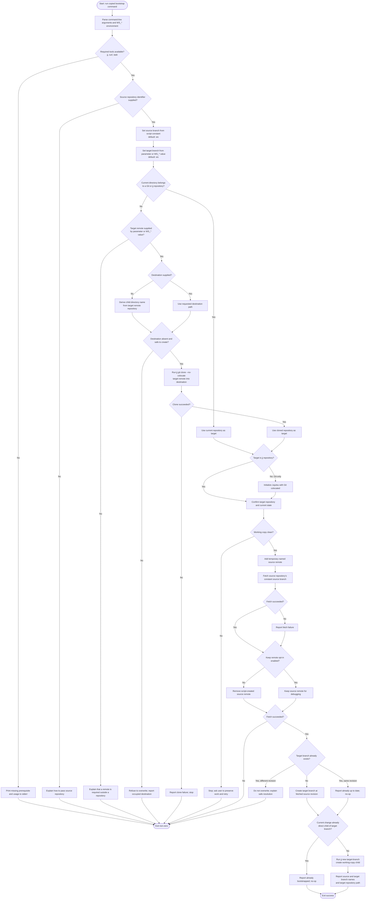

# Bootstrap the workspace-hub branch

This repository provides a `ws` branch that can be added to a Git or Jujutsu
repository as a set of workspace-hub instructions and tools. The bootstrap
command is intended to be copied from a generated GitHub README.

The command downloads and runs `bootstrap.sh` directly from GitHub raw file
hosting. The generated command passes the source repository identifier
explicitly. The script fetches a configurable source branch (default `ws`)
from that repository and makes it available under a separately configurable
target branch name (also default `ws`) in the target repository. Source and
target branch names may differ.

Supported targets are Git repositories and Git-backed Jujutsu repositories.
When run inside an existing Git-only repository, the script initializes
Jujutsu with Git colocated. When run inside an existing Jujutsu repository, it
preserves that repository's current colocation setting. When run outside a
repository, the caller must provide the target repository's Git remote. The
script then runs `jj git clone --no-colocate` into a child directory named
after the remote repository, or into a caller-selected destination directory.

The bootstrap process ensures the target is a Jujutsu repository, fetches the
source branch under the configured target branch name, then runs
`jj new <target-branch>`. This creates a new working-copy change whose parent
is the target branch, making the workspace-hub files available in the working
directory. It does not move or overwrite another branch. The working-copy
revision and files do change to reflect the new child change; existing work
must be preserved, not discarded.

The script is not written yet. This section specifies the intended behavior
before implementation.

## Prerequisites

- [Jujutsu (`jj`)](https://jj-vcs.github.io/jj/)
- `curl`
- [Task](https://www.taskfile.dev/)

## Bootstrap requirements

- Support Alpine Linux and common Linux/macOS environments using POSIX shell,
  `jj`, `curl`, and Task. Do not require Bash or GNU-only utilities.
- Accept optional command-line parameters and/or environment variables for
  the source repository, target remote, target branch name, and clone
  destination. Every environment variable used by the script must use the
  `WS_` prefix. Validate inputs and show concise usage help.
- Keep the originating/source branch name in a clearly named script constant,
  defaulting to `ws`, so it is easy to change when needed. Do not expose this
  as a routine user parameter.
- Allow the target branch name to be configured by parameter or `WS_`
  environment variable; default it to `ws`. It may differ from the source
  branch name.
- From an existing Git or Jujutsu repository, use that repository as the
  target. If it is Git-only, initialize Jujutsu with Git colocated before
  fetching. Support Git-backed repositories only; leave the colocation
  setting of an existing Jujutsu repository unchanged.
- Outside a repository, require a target Git remote, then clone it with
  `jj git clone --no-colocate` into a child directory named after the remote
  repository, unless an explicit destination parameter/environment variable
  selects another path. Do not overwrite existing files or repositories; fail
  with actionable guidance if the destination is occupied.
- Fetch the source branch through a dedicated temporary source remote. Remove
  only the remote created by the script when finished, unless an opt-in
  parameter or `WS_` environment variable requests that it be kept for
  debugging. Never remove or alter a remote that existed before the script
  ran.
- Determine the source repository from an explicit bootstrap-command
  parameter/environment variable, not by guessing from the target
  repository's `origin`.
- Ensure there is a Jujutsu repository before fetching. A `jj git clone
  --no-colocate` target already satisfies this; initialize Jujutsu for an
  existing Git-only target.
- For an existing target repository, require a clean working copy before
  proceeding. If it is dirty, stop before fetching or creating a change and
  tell the user to preserve/commit their work and retry.
- After a successful fetch and target-branch conflict check, run
  `jj new <target-branch>` so the new working-copy change has the target
  branch as its parent and the hub files are present in the working directory.
  This intentionally changes the active working-copy revision and contents.
  Preserve existing work and stop safely if the operation cannot do so.
- Make reruns idempotent: if the current working-copy change is already a
  direct child of the configured target branch, report success without
  creating another change.
- Avoid silently replacing an existing local target branch or unrelated refs.
  If the target already has a conflicting target branch, report it and explain
  how to proceed rather than force-updating it.
- Be safe to rerun: detect an already-present matching branch and report
  success or no-op; do not duplicate workspaces or rewrite user history.
- Do not create, remove, or modify a workspace as a side effect. Workspace
  creation and cleanup remain explicit agent/operator actions governed by
  `AGENTS.md`.
- Keep diagnostics on standard error and return a non-zero exit status for
  failures. Do not require elevated privileges.
- Do not rely on project-specific repository names, default branches, or
  source-code layout.

## Proposed implementation split

Keep `bootstrap.sh` as a small POSIX-shell launcher and put the repository
checks, argument-to-task-variable mapping, clone/fetch/branch logic, and
`jj new` idempotence checks in a dedicated `Taskfile-bootstrap.yml`.
Prefer a dedicated file over adding bootstrap tasks to the target repository's
Taskfile: the target may have its own unrelated Taskfile, and bootstrap logic
should not collide with or modify project automation.

The launcher would validate that `curl`, `jj`, and `task` are available,
download the dedicated Taskfile to a temporary location, invoke it with the
provided settings, and clean up the temporary file. Keep the source branch
default in the script as the agreed constant and pass it to the task as a
setting. This does not make the shell launcher itself Windows-native; a
PowerShell launcher (or another native entrypoint) would still be needed for
future Windows support. Task can run on Windows, but its tasks are only
cross-platform when the commands and tools they use are also portable.

Task supports named variables and environment-driven configuration, which
fits the agreed `WS_*` settings. It does not remove the need to carefully
handle quoting, paths, command failures, Jujutsu/Git state, and platform
differences. Keep those operations small and explicit rather than building a
general-purpose argument parser in Task templates.

## Settled design decisions

- The generated command passes the source repository identifier explicitly
  (for example, `owner/repository`); the script must not infer it from the
  target repository's `origin`.
- A target Git remote is supplied with a parameter or `WS_`-prefixed
  environment variable when bootstrapping outside an existing repository.
- Outside a repository, the default clone destination is a child directory
  named after the remote repository. A parameter or `WS_`-prefixed variable
  can select a different destination path. This selects the destination; it
  does not authorize overwriting existing files.
- Use a temporary named remote for the source repository. Remove that
  script-created remote by default; an opt-in parameter or `WS_`-prefixed
  environment variable keeps it for debugging. Never remove a pre-existing
  remote.
- Support Git-only targets by initializing Jujutsu colocated. Preserve the
  existing colocation mode of Jujutsu targets. When cloning a target, use
  `jj git clone --no-colocate`. Pure Jujutsu repositories without a Git
  backend are out of scope.
- Never force-update a conflicting target branch. Report the conflict and
  provide safe recovery guidance.
- Only create the child working-copy change when the target working copy is
  clean; refuse to proceed on a dirty working copy.
- If the current working-copy change is already directly parented by the
  target branch, do not create another child change on rerun.
- The source branch is a script constant, defaulting to `ws`. The target
  branch is independently configurable with a parameter or `WS_`-prefixed
  variable, also defaulting to `ws`.

## Bootstrap logic

The flow below specifies the intended `bootstrap.sh` behavior. Any validation
or safety check that fails must stop before changing the target repository,
except that initializing Jujutsu in a Git-only repository is required setup.

The source and target branch names are deliberately separate: for example,
the script may fetch source branch `ws` and expose it locally under a
differently named target branch. `jj new <target-branch>` creates a new child
working-copy change; it does not check out or move the target branch itself.
Bootstrap must not create or remove workspaces. Only a temporary remote
created by the script is eligible for cleanup.

## Glossary

- **Source repository**: The repository identified by the copied bootstrap
  command. It supplies `bootstrap.sh` and the source branch.
- **Source branch**: The branch in the source repository to fetch. It defaults
  to `ws` and is held as a script constant.
- **Target branch**: The local branch name under which the source branch is
  made available in the target repository. It defaults to `ws` and may be
  configured independently of the source branch.
- **Target repository**: The Git or Jujutsu repository in the current
  directory where the source branch is to be made available under the target
  branch name; if none exists, this is the repository cloned from the supplied
  remote.
- **Workspace-hub branch (`ws`)**: A dedicated branch containing generic
  workspace-management guidance and tools, separate from the target
  repository's project changes.
- **Bootstrap command**: The copyable shell command in a generated README
  that downloads and executes the source repository's raw `bootstrap.sh`.
- **Fetch**: Retrieve branch data and make a reference available locally
  without checking it out or merging it into the current working copy.
- **Temporary source remote**: A named Git remote added by the bootstrap
  process to fetch the source branch. It is removed after use by default and
  can be retained through an explicit debugging opt-in.
- **Jujutsu repository**: A repository managed by `jj`, whether or not it
  uses colocated or non-colocated Git storage. This bootstrap supports
  Git-backed Jujutsu repositories only.
- **Isolated work session**: A discrete agent task carried out in a newly
  created Jujutsu workspace. Agents create a fresh workspace at session start
  and clean it up after the work is safely preserved.
- **Workspace**: A separate working directory registered with the same
  Jujutsu repository, used to isolate changes from the hub root and other
  sessions.
